# Лабораторная работа №3. Облачные сети. Amazon VPC

## Шапка

- **ФИО:** Rusnak Daniel
- **Группа:** IA2404
- **Специальность:** Informatică aplicată
- **Номер k в группе:** 14, **X = k % 30 = 14**
- **Выбранный уровень:** продвинутый (задания 1–14)
- **Приложение:** `open_capsules_php_functional` (TimeCapsule)
- **Репозиторий:** https://github.com/DanielRusnak2025-cloud/timecapsule

---

## Базовый уровень

### Задание 1. План адресов

| Подсеть | Зона доступности | Диапазон | Первый и последний адрес для экземпляров | Доступно адресов |
|---|---|---|---|---|
| public-a | eu-central-1a | 10.14.0.0/24 | 10.14.0.4 – 10.14.0.254 | 251 |
| public-b | eu-central-1b | 10.14.1.0/24 | 10.14.1.4 – 10.14.1.254 | 251 |
| private-a | eu-central-1a | 10.14.10.0/24 | 10.14.10.4 – 10.14.10.254 | 251 |
| private-b | eu-central-1b | 10.14.11.0/24 | 10.14.11.4 – 10.14.11.254 | 251 |

**Ответы на вопросы задания 1:**
- **Почему доступных адресов не 256?** В каждой /24 (256 адресов) AWS резервирует 5: сетевой адрес (`.0`), адрес VPC-роутера (`.1`), DNS-сервера VPC (`.2`), зарезервированный на будущее (`.3`) и широковещательный (`.255`, хоть broadcast в VPC и не используется). Остаётся 251 адрес для экземпляров.
- **Сколько ещё /24 поместится в VPC?** VPC — это /16 (10.14.0.0/16 = 65 536 адресов = 256 подсетей /24). Мы заняли 4, значит свободно ещё 252 подсети /24.

### Задание 2. VPC и подсети

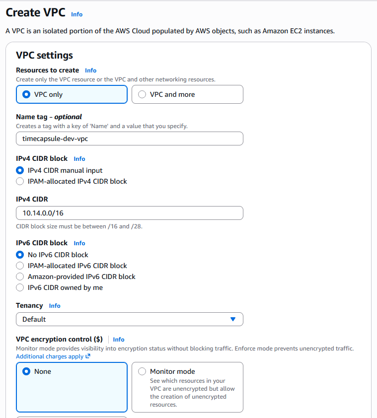
Создание VPC `timecapsule-dev-vpc` с диапазоном 10.14.0.0/16.

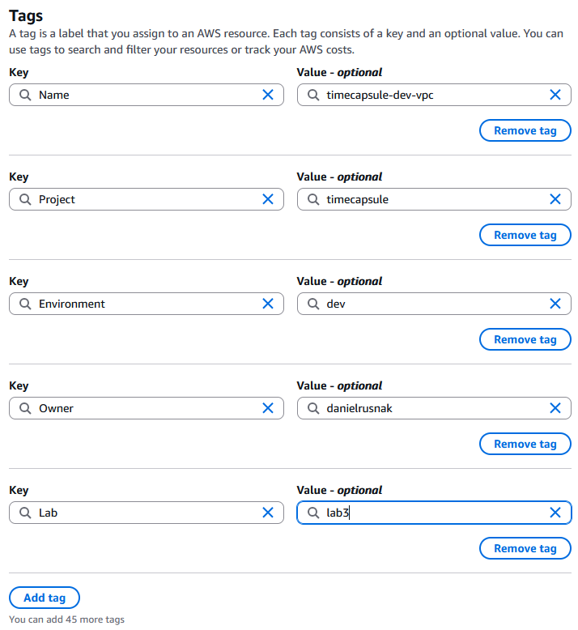
Включены DNS resolution и DNS hostnames.

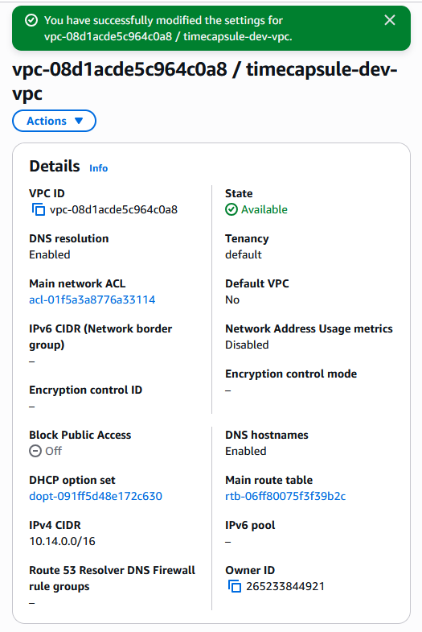
VPC создан, отображается в списке.

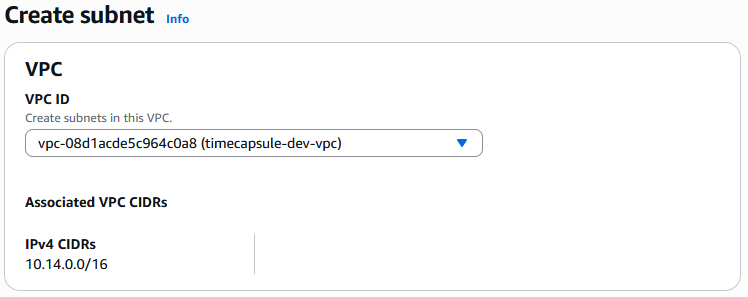
Форма создания подсетей в новой VPC.

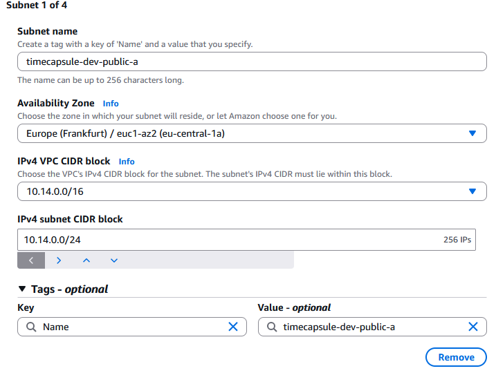
Настройки подсети public-a (eu-central-1a, 10.14.0.0/24).

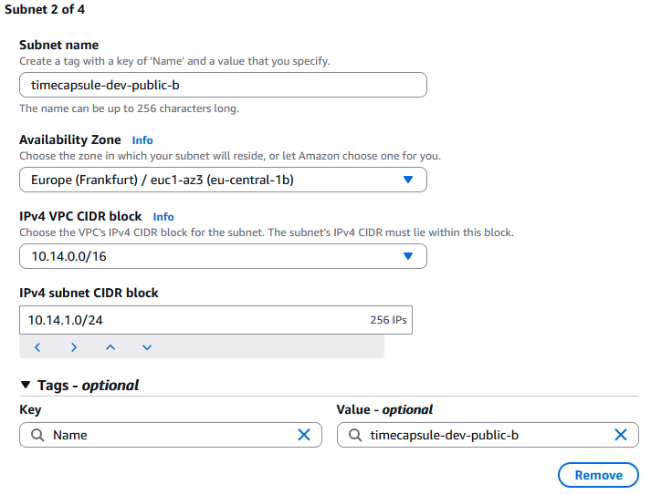
Настройки подсети public-b (eu-central-1b, 10.14.1.0/24).

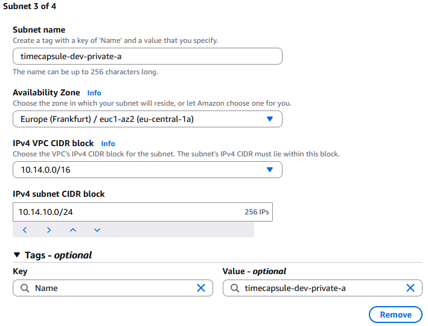
Настройки подсети private-a (eu-central-1a, 10.14.10.0/24).

Настройки подсети private-b (eu-central-1b, 10.14.11.0/24).

Создан VPC `timecapsule-dev-vpc` (10.14.0.0/16, без IPv6), включены Enable DNS resolution и Enable DNS hostnames, созданы 4 подсети с обязательными тегами.

**Ответ на вопрос задания 2:**
- **Является ли public-a сейчас публичной?** Нет. На этом шаге это обычная подсеть: публичной её делает не имя, а маршрут в Internet Gateway в связанной таблице маршрутов (его мы добавляем в задании 3) и автовыдача публичного IP. Пока ни того, ни другого нет — подсеть не публична.

### Задание 3. Internet Gateway и таблицы маршрутов

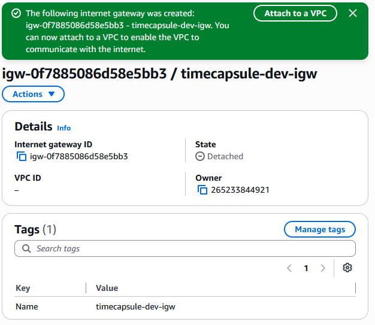
IGW `timecapsule-dev-igw` подключён к VPC.

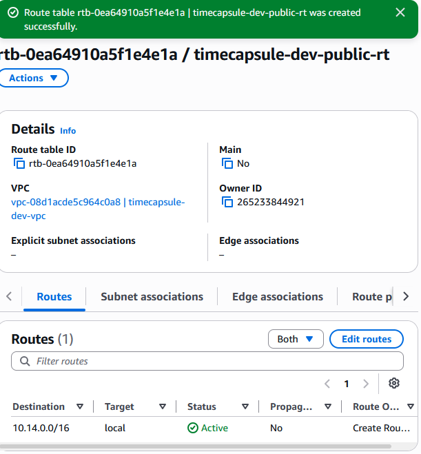
Созданы таблицы маршрутов `public-rt` и `private-rt`.

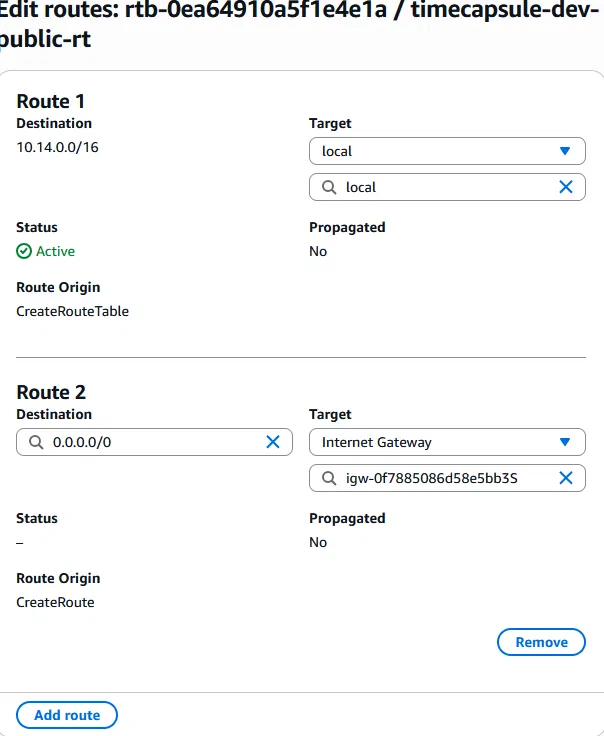
Добавление маршрута 0.0.0.0/0 → IGW в `public-rt`.

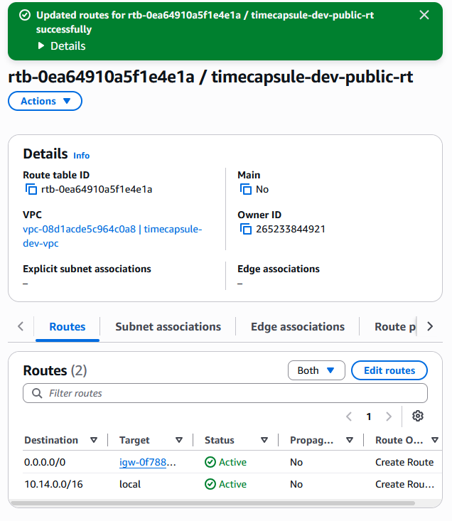
`public-rt` с активным маршрутом через IGW.

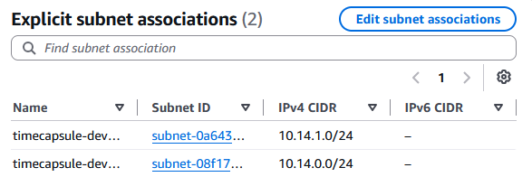
public-a и public-b явно привязаны к `public-rt`.

private-a и private-b привязаны к `private-rt`.

Включение Auto-assign Public IPv4 для публичных подсетей.

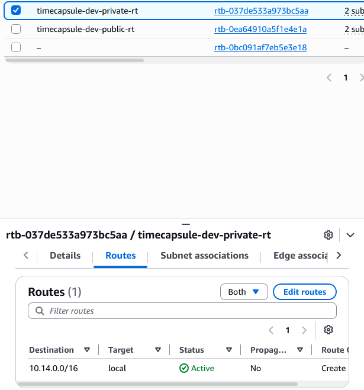
`private-rt` без маршрута в интернет — изоляция приватных серверов подтверждена.

Создан и подключён IGW `timecapsule-dev-igw`. В `public-rt` маршрут 0.0.0.0/0 → IGW, связана с public-a/public-b. `private-rt` без маршрута в интернет, связана с private-a/private-b. Для публичных подсетей включён auto-assign public IPv4.

**Ответы на вопросы задания 3:**
- **Какой маршрут есть в обеих таблицах, хотя вы его не добавляли?** Локальный маршрут `10.14.0.0/16 → local`. Он создаётся автоматически и даёт связность между всеми подсетями внутри VPC.
- **Что он даёт?** Любой сервер VPC может общаться с любым другим по приватным адресам, в том числе из разных зон доступности, без шлюзов.
- **Куда уйдёт пакет из private-a на 8.8.8.8?** Никуда — будет отброшен. В `private-rt` нет маршрута 0.0.0.0/0 (пока нет NAT), а под локальный `10.14.0.0/16` адрес 8.8.8.8 не попадает. Маршрута наружу нет — пакет теряется.

### Задание 4. Security Group

`bastion-sg`: входящий SSH 22 разрешён только с My IP.

`web-sg`: HTTP 80 (0.0.0.0/0) и SSH 22 от bastion-sg.

`db-sg`: PostgreSQL 5432 от web-sg, SSH 22 от bastion-sg.

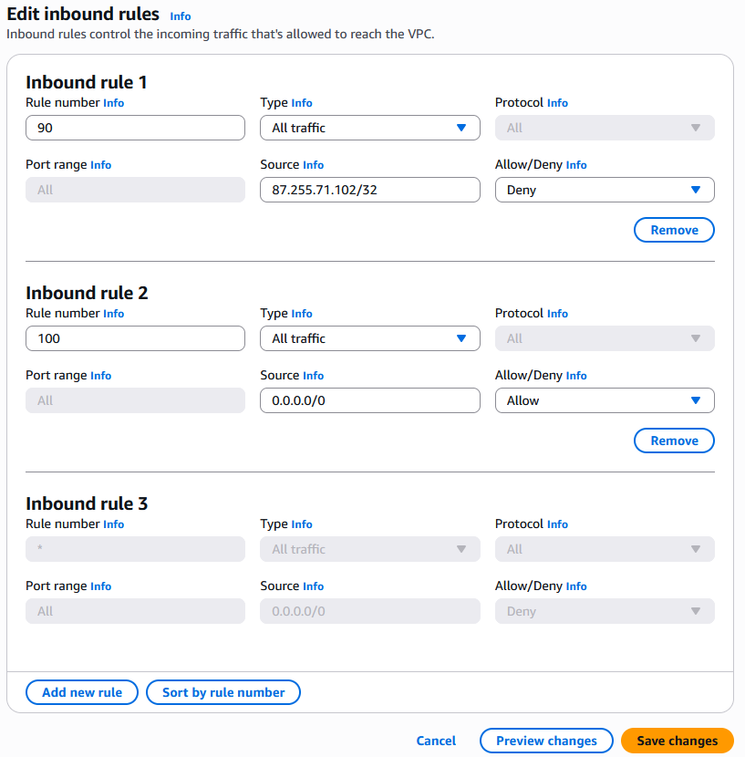
Итоговые входящие правила всех трёх групп безопасности.

| Группа | Входящее | Источник |
|---|---|---|
| bastion-sg | SSH 22 | My IP |
| web-sg | HTTP 80 | 0.0.0.0/0 |
| web-sg | SSH 22 | bastion-sg |
| db-sg | PostgreSQL 5432 | web-sg |
| db-sg | SSH 22 | bastion-sg |

**Ответ на вопрос задания 4:**
- **Почему в db-sg источник — группа web-sg, а не адрес или диапазон 10.14.0.0/16?** Ссылка на группу означает «пускать любой сервер, входящий в web-sg», независимо от его IP. Адрес сервера может смениться при пересоздании, а диапазон 10.14.0.0/16 открыл бы базу всем серверам VPC, включая bastion и будущие. Ссылка на группу — самый узкий и устойчивый к изменениям способ: только веб-серверы, и автоматически.

### Задание 5. Экземпляры

Создание ключевой пары `drusnak-keypair-fra` для SSH-доступа.

Имя и теги первого экземпляра (bastion).

Сетевые настройки при запуске: VPC, подсеть, Security Group.

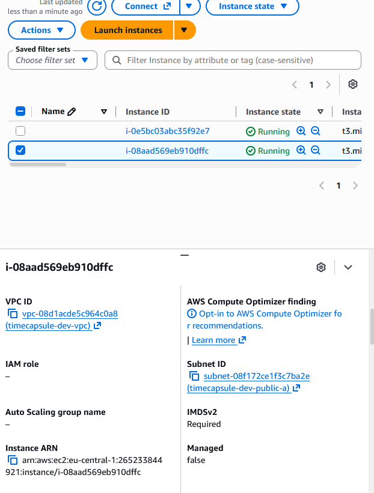
Запуск web-server в public-a (nginx через User data).

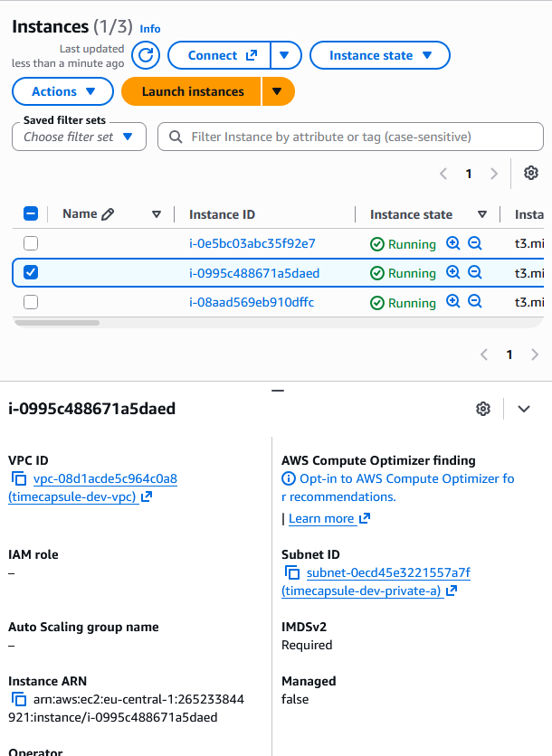
Запуск db-server в private-a без публичного IP.

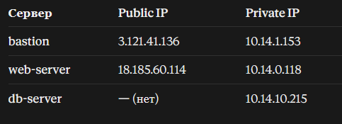
Три запущенных экземпляра с их публичными и приватными адресами.

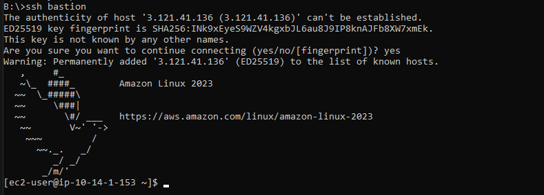
Успешное SSH-подключение к bastion.

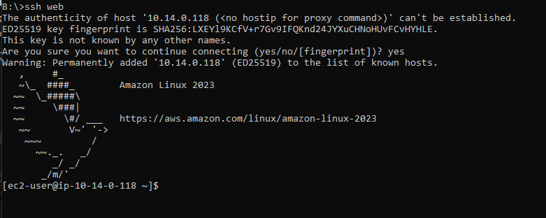
SSH к web-server через ProxyJump via bastion.

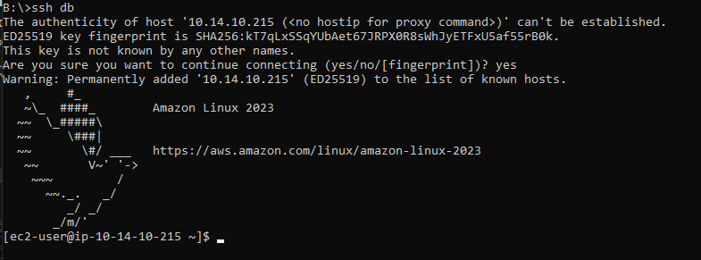
SSH к db-server через ProxyJump via bastion.

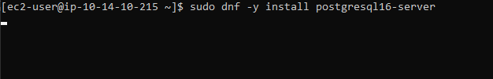
`dnf install` на db-server зависает — исходящего маршрута нет.

Запущены bastion (public-b), web-server (public-a, nginx через User data), db-server (private-a, без публичного IP). Настроен `~/.ssh/config` с ProxyJump через bastion, проверены `ssh bastion`, `ssh web`, `ssh db`.

**Ответ на вопрос задания 5:**
- **Почему db-server не может скачать пакеты, а web-server может?** У web-server есть публичный IP и маршрут в IGW (public-rt), поэтому он выходит в интернет. У db-server нет публичного адреса и его private-rt не имеет маршрута наружу — пакеты в интернет уходить некуда, `dnf` зависает. Чтобы это исправить, не открывая db-server из интернета, нужен **NAT Gateway** в публичной подсети + маршрут 0.0.0.0/0 → NAT в private-rt: он выпускает исходящие соединения, но не пускает входящие.

### Задание 6. Временный NAT Gateway

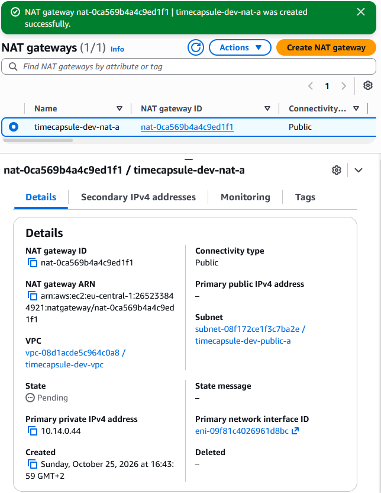
Создание временного NAT Gateway в public-a с Elastic IP.

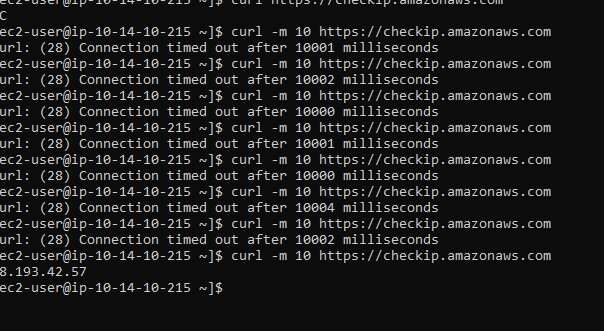
`curl checkip.amazonaws.com` с db-server: виден Elastic IP NAT, а не 10.14.10.x.

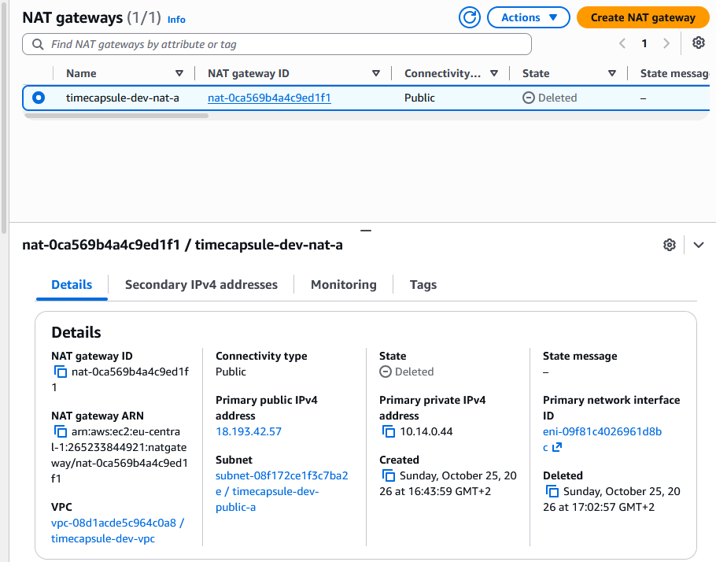
NAT Gateway удалён (состояние Deleted) после установки PostgreSQL.

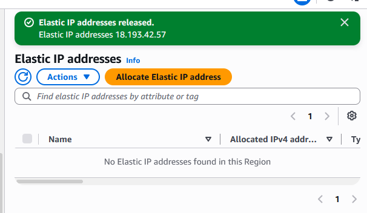
Elastic IP освобождён — расходы на NAT обнулены.

Создан временный NAT Gateway в public-a, добавлен маршрут в private-rt, установлен PostgreSQL на db-server, затем NAT удалён, маршрут (Blackhole) удалён, Elastic IP освобождён.

**Ответы на вопросы задания 6:**
- **Какой адрес вернул checkip и почему не адрес db-server?** Вернулся Elastic IP NAT Gateway. Для внешнего мира все серверы приватной подсети выходят в интернет под общим адресом NAT; свой приватный 10.14.10.x db-server наружу не показывает — NAT подменяет адрес источника (это и есть «трансляция адресов»).
- **Три механизма защиты базы — что делает каждый и что будет при ошибке в одном?** (1) *Отсутствие публичного адреса и маршрута в IGW* — к серверу вообще нет дороги из интернета. (2) *Security Group db-sg* — пускает только 5432 от web-sg и 22 от bastion-sg. (3) *pg_hba.conf* — на уровне самой БД решает, с каких адресов и кому можно войти по паролю. Это слои защиты: ошибка в одном не открывает базу, пока держат остальные (например, даже при слишком широком pg_hba.conf порт закрыт Security Group, а без публичного маршрута снаружи всё равно не достучаться).
- **Почему PostgreSQL работает после удаления NAT?** NAT нужен только для *исходящих* соединений (скачать пакеты). Сама БД принимает *входящие* подключения изнутри VPC по локальному маршруту — он никуда не делся. Когда понадобятся обновления безопасности, NAT Gateway создают снова на время установки и опять удаляют.

### Задание 7. Проверки

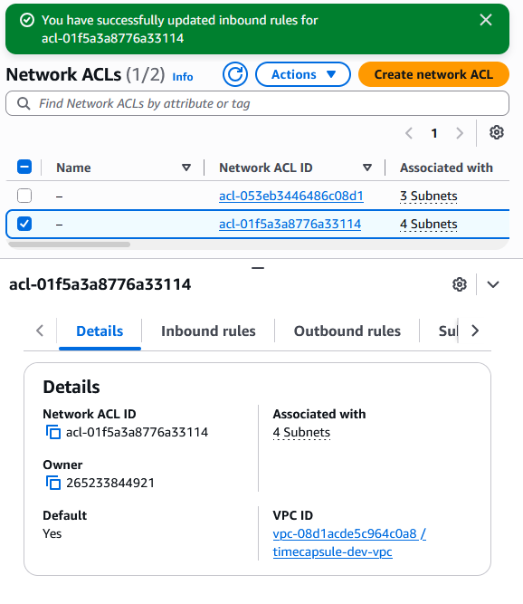
Эксперимент с Network ACL: правило Deny для текущего IP блокирует SSH и HTTP.

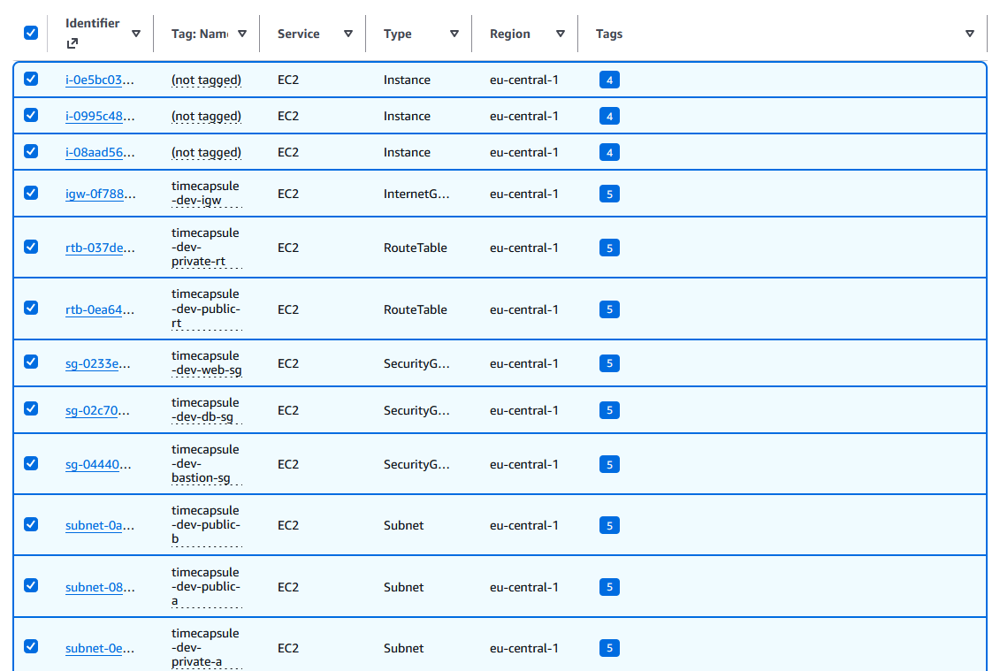
Tag Editor — все ресурсы проекта найдены по тегу `Project=timecapsule`.

**Ответы на вопросы задания 7:**
- **Почему порт 5432 открыт с web-server, но закрыт с bastion?** db-sg пускает 5432 только от источника web-sg. web-server входит в web-sg → соединение проходит. bastion в bastion-sg, а не web-sg → его на 5432 не пускают, хотя оба в одной VPC и маршрут между ними есть. Фильтрует Security Group, а не маршрут.
- **Почему curl с db-server не проходит? Можно ли из интернета достучаться до 5432?** Исходящий запрос с db-server не проходит, потому что NAT удалён и маршрута наружу нет. Из интернета к 5432 подключиться нельзя по цепочке: нет маршрута (в private-rt нет 0.0.0.0/0 и нет IGW для приватной подсети), нет публичного адреса (некуда слать пакет), и фильтры (db-sg пускает только от web-sg) — отказ на каждом шаге.
- **Network ACL — почему блокируется и SSH, и сайт, хотя SG не меняли? Почему с телефона работает? Почему номер < 100?** Network ACL фильтрует трафик на границе подсети **до** Security Group, и правило Deny для вашего IP режет весь трафик с этого адреса — и SSH, и HTTP. С телефона (мобильный интернет) адрес другой, под Deny не попадает — сайт открывается. Номер должен быть < 100, потому что правила ACL применяются по возрастанию номера, и стандартное разрешающее правило имеет номер 100: правило 90 срабатывает раньше и побеждает.
- **Как по тегам найти всё для удаления? Зачем Owner на личном аккаунте?** Через Tag Editor по тегу `Project = timecapsule` (или `Lab = lab3`) находятся все ресурсы проекта — их список и есть то, что удалять. Тег Owner даже на личном аккаунте полезен: это привычка рабочего соглашения, он показывает ответственного в общих аккаунтах и помогает считать расходы по владельцу.

---

## Продвинутый уровень

### Задание 8. Перенос сервера ЛР2 в новую сеть

Создание AMI `timecapsule-dev-app-lab2` из webserver ЛР2.

Копирование образа в регион eu-central-1.

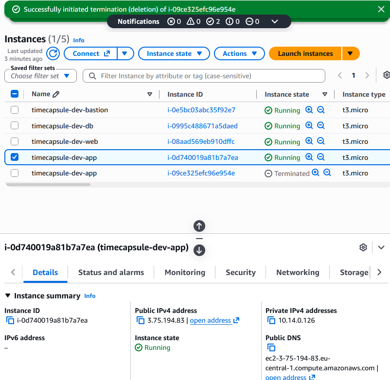
Запуск app-server из образа в подсети public-a (web-sg).

SSH к app-server — ОС, nginx, PHP и код приложения уже на месте.

Из webserver ЛР2 создан образ `timecapsule-dev-app-lab2`, из него запущен app-server в public-a (web-sg). web-server из Части 1 завершён.

**Ответ на вопрос задания 8:**
- **Что содержит образ? Какие данные из ЛР2 на app-server без установки? Где сейчас база?** Образ (AMI) — снимок дисков webserver со всем содержимым: ОС, nginx, PHP, код приложения, настройки, и локальная база PostgreSQL ЛР2. Всё это оказалось на app-server без установки. База данных сейчас — локальная копия внутри образа на самом app-server (её мы перенесём на db-server в задании 12).

### Задание 9. Elastic IP

Выделение и привязка Elastic IP `timecapsule-dev-app-eip` к app-server.

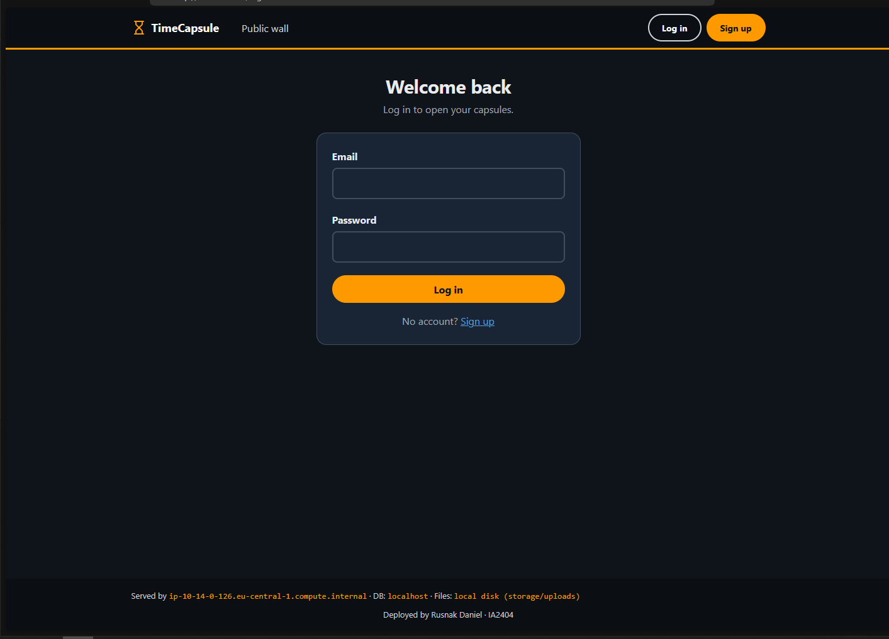
Приложение TimeCapsule открывается по постоянному Elastic IP.

Выделен и привязан к app-server Elastic IP `timecapsule-dev-app-eip`, в .env обновлён APP_URL, перезапущен PHP-FPM.

**Ответы на вопросы задания 9:**
- **Почему Elastic IP нужен app-server, но не bastion?** app-server — публичный сервис с постоянным адресом: пользователи и APP_URL завязаны на него, адрес не должен меняться при остановке/запуске. bastion — лишь точка входа для администратора, его меняющийся адрес не проблема (достаточно обновить HostName в ssh config).
- **Сколько стоит Elastic IP у остановленного сервера и почему?** Он тарифицируется даже когда сервер остановлен ($0,005/час). AWS берёт плату за зарезервированный, но простаивающий публичный адрес — это дефицитный ресурс, и так стимулируют освобождать неиспользуемые.
- **Понадобится ли Elastic IP, когда появится балансировщик?** Нет. Постоянным публичным адресом станет балансировщик, а app-server спрячутся за ним в приватных подсетях без собственных публичных адресов — Elastic IP на сервере станет не нужен.

### Задание 10. База данных приложения на db-server

Созданы пользователь `timecapsule` и база `timecapsule` на db-server (новый пароль), pg_hba.conf ужесточён: только пользователь timecapsule в базу timecapsule.

**Ответ на вопрос задания 10:**
- **Зачем новый сильный пароль, если 5432 закрыт Security Group?** Это защита в глубину. Security Group — внешний барьер, но если он будет ошибочно расширен или угрозу создаст скомпрометированный веб-сервер (он-то имеет доступ к 5432), пароль остаётся последней преградой. Один слой защиты не должен быть единственным.

### Задание 11. Приватная зона Route 53

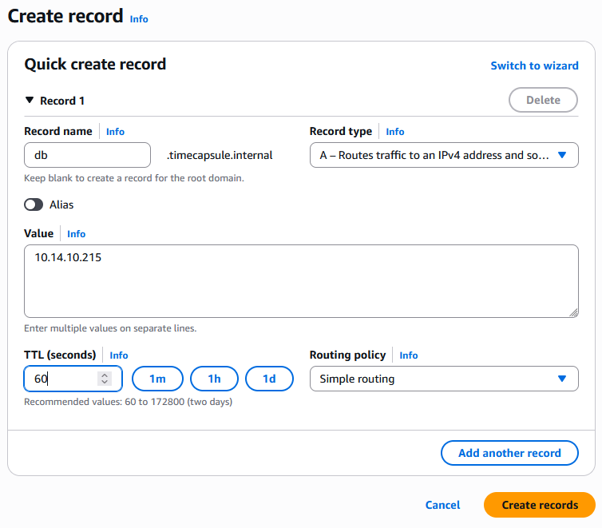
Запись A `db.timecapsule.internal` → приватный IP db-server (TTL 60).

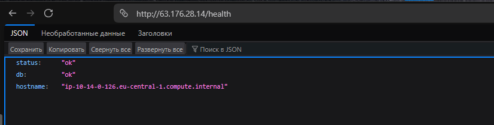
`dig` с app-server находит имя; с внешнего компьютера — не находит.

Создана приватная зона `timecapsule.internal`, связана с VPC, запись A `db` → приватный IP db-server (TTL 60).

**Ответы на вопросы задания 11:**
- **Почему с app-server имя находится, а с компьютера нет?** Приватная зона Route 53 связана только с вашей VPC и обслуживается внутренним DNS VPC. Имя `db.timecapsule.internal` видят лишь серверы этой VPC; ваш компьютер снаружи к этому DNS не обращается, для него имени не существует.
- **Что менять, если db-server пересоздадут с другим адресом?** Только значение записи A `db` в зоне (новый приватный IP). Приложение обращается по имени, поэтому .env и код трогать не нужно — в этом и смысл DNS-имени.

### Задание 12. Перенос данных и переключение приложения

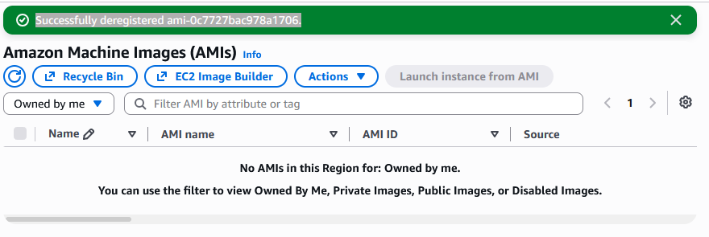
Образ `timecapsule-dev-app-lab2` дерегистрирован, снимок EBS удалён после переноса данных.

Данные выгружены `pg_dump` с локальной базы, загружены в базу на db-server через `db.timecapsule.internal`, в .env DB_HOST переключён на имя зоны, локальная база отключена. Образ `timecapsule-dev-app-lab2` дерегистрирован, снимок удалён.

**Ответ на вопрос задания 12:**
- **Где лежат файлы, прикреплённые к капсулам, и что с ними будет при удалении app-server?** Они на диске app-server (папка storage/uploads), переехали вместе с образом, а **не** с базой (в базе только метаданные). Если app-server удалить — вложения пропадут вместе с его диском. Это и есть проблема, которую решает ЛР4: вынос файлов в S3.

### Задание 13. Деплой и обслуживание

Версия с меткой «LR3» задеплоена командой `ssh app ./deploy.sh`.

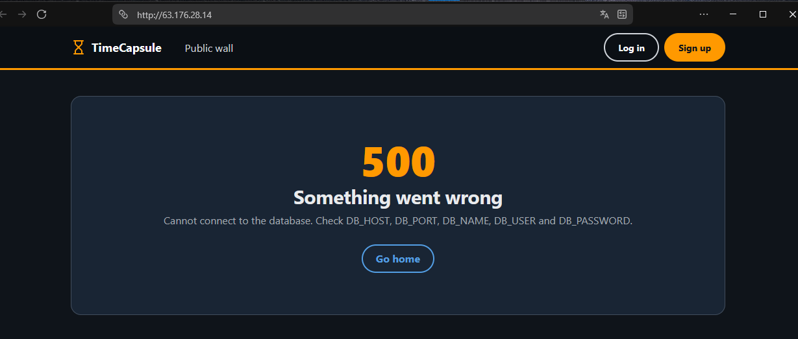
`/health` возвращает `db:error` при остановленном db-server (задержка ~30 с на таймаут).

Выпущена новая версия (строка «LR3» в подвале) через `ssh app ./deploy.sh`. Проверен отказ базы (остановка/запуск db-server). Обновления на db-server — через временный NAT (вариант B, скрипты `scripts/nat-up.sh` и `scripts/nat-down.sh`).

**Ответы на вопросы задания 13:**
- **Почему в deploy.sh ничего менять не пришлось?** Благодаря `~/.ssh/config` с ProxyJump: `ssh app` сам ходит через bastion, а на самом сервере команды деплоя (git pull, composer install, reload) те же. Смена сети не затронула шаги выкладки.
- **Что показал /health при остановленной базе и менялся ли адрес db-server?** `/health` вернул `db:error` (PHP отвечает, но не может подключиться к базе), причём с задержкой ~полминуты — приложение ждёт таймаута соединения. Приватный адрес db-server после остановки/запуска **не меняется** (он в приватной подсети, не Elastic/публичный), поэтому после запуска базы приложение заработало само, без правок.
- **Почему nat-down.sh освобождает Elastic IP только после удаления NAT?** Пока NAT Gateway существует, его Elastic IP привязан к шлюзу и освободить (release) его нельзя — AWS вернёт ошибку. Сначала удаляем NAT, дожидаемся состояния Deleted, и только потом освобождаем адрес.

---

## Архитектура

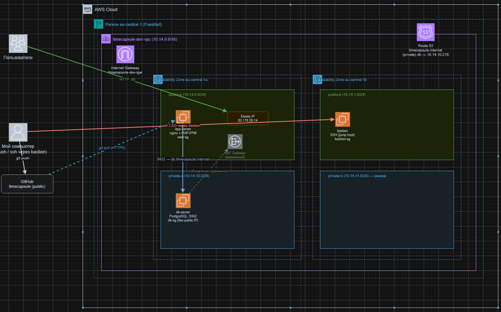
Схема VPC: IGW, две зоны доступности, четыре подсети, bastion/app-server/db-server с группами безопасности, приватная зона Route 53, временный NAT Gateway (пунктир).

**ADR:** [docs/adr/0002-database-placement.md](../adr/0002-database-placement.md)

---

## Дополнительные устные вопросы (продвинутый уровень)

**Как проходит запрос от браузера до базы?** Браузер → по интернету на Elastic IP app-server → Internet Gateway → public-rt направляет в public-a → Security Group web-sg пропускает порт 80 → nginx → PHP-FPM. Приложению нужны данные → оно идёт на `db.timecapsule.internal` (DNS VPC отдаёт приватный IP) → по локальному маршруту VPC в private-a → Security Group db-sg пропускает 5432 только от web-sg → PostgreSQL проверяет пароль по pg_hba.conf и отвечает.

**Что нужно злоумышленнику, знающему приватный IP db-server?** Приватный IP сам по себе бесполезен снаружи: к private-a нет маршрута из интернета. Нужно оказаться **внутри** VPC и именно в составе web-sg (db-sg пускает 5432 только оттуда) — то есть скомпрометировать веб-сервер, — и вдобавок знать логин и пароль базы (pg_hba.conf требует пароль). Нужны все условия сразу.

**Чем временный NAT лучше постоянного и какие неудобства?** Постоянный NAT Gateway стоит ~$1,25/сутки круглосуточно, даже когда не нужен. Временный создают на минуты для установки пакетов и удаляют — экономия почти до нуля. Неудобство: каждый раз его надо поднимать и убирать (отсюда скрипты nat-up/nat-down), и пока его нет, у приватных серверов нет выхода в интернет.

**Как пережить отказ зоны eu-central-1a?** Сейчас app-server и db-server в зоне a — её отказ кладёт сервис. Нужны: второй сервер приложения в зоне b за балансировщиком, резервная база в зоне b (реплика/standby, например Multi-AZ RDS), и подсети/ресурсы во второй зоне. Схема подсетей в двух зонах у нас уже есть, но серверов и репликации пока не хватает.

---

## Вывод
Построена собственная сеть в AWS: VPC с четырьмя подсетями в двух зонах, публичный выход через Internet Gateway, приватные подсети без прямого доступа из интернета. Приложение TimeCapsule перенесено в новую сеть: app-server с постоянным Elastic IP в публичной подсети, база PostgreSQL — на отдельном db-server в приватной подсети, доступном только веб-серверу и только по имени `db.timecapsule.internal`. Доступ администратора идёт через bastion, обновления приватных серверов — через временный NAT Gateway.

## Список источников
1. Условие ЛР3 (CCru, USM).
2. Лекция 5 «Виртуальные сети в облаке. Amazon VPC», Hands-on 5.1.
3. Документация AWS: VPC, Subnets, Route Tables, Internet Gateway, NAT Gateway, Security Groups, Network ACL, Route 53 Private Hosted Zones.
