# Лабораторная работа №4. Облачные хранилища. Amazon S3

- **ФИО:** Rusnak Daniel
- **Группа:** IA2404
- **Специальность:** Informatică aplicată
- **Уровень:** Продвинутый (задания 1–14)
- **Репозиторий:** https://github.com/DanielRusnak2025-cloud/timecapsule
- **Регион:** eu-central-1 (Frankfurt)

---

## Цель работы

Научиться хранить файлы в объектном хранилище Amazon S3 и управлять ими:
создавать бакет и объекты в консоли и из командной строки, защищать данные
версионированием, ограничивать рост хранилища правилами жизненного цикла и
управлять доступом с помощью политик. Затем перенести загруженные файлы
приложения из ЛР3 с диска сервера в S3, чтобы сервер приложения перестал
хранить данные пользователей.

**Бакет:** `timecapsule-dev-uploads-danielrusnak2025`

---

# Часть 1. Базовый уровень

## Задание 1. Бакет и объекты в консоли

Создан бакет `timecapsule-dev-uploads-danielrusnak2025`: тип General purpose,
ACLs disabled, Block all public access, шифрование SSE-S3, обязательные теги
(Environment=dev, Lab=Lab4, Owner=danielrusnak, Project=timecapsule). В бакете
созданы папки `uploads/` (картинка, PDF) и `backups/` (текстовый файл).

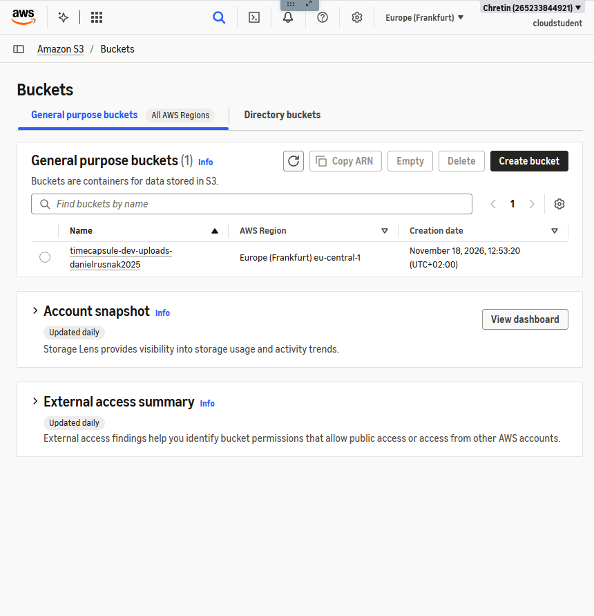
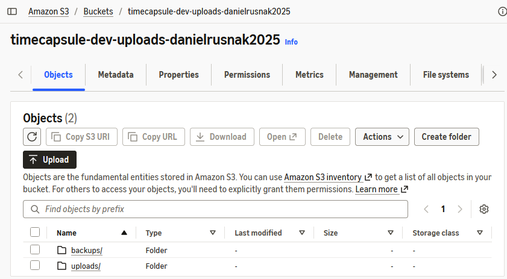
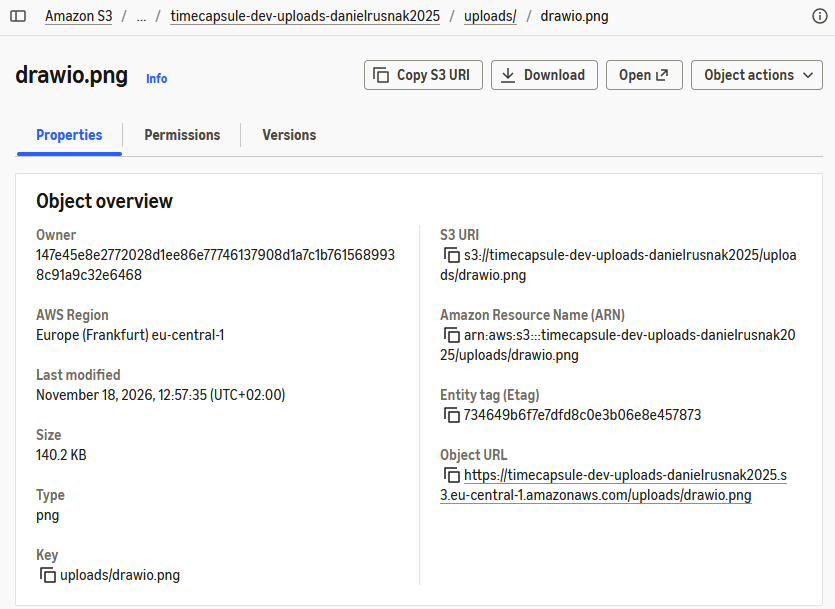

**Контрольные вопросы:**

- **Какой ключ у картинки?** Ключ — это полный путь-имя объекта внутри бакета,
  например `uploads/drawio.png`. В S3 нет настоящих папок: «папка» — это часть
  ключа до символа `/`.
- **Почему Object URL не открывается, хотя я владелец бакета?** Бакет закрыт
  Block Public Access, публичной политики нет. Object URL — это анонимный
  запрос без подписи, поэтому S3 отвечает AccessDenied. Владение бакетом в
  браузере не передаётся: нужен либо вход с подписью, либо presigned URL.
- **Что на самом деле создала кнопка Create folder?** Объект нулевого размера с
  ключом, заканчивающимся на `/` (например `uploads/`). Это не каталог, а
  «пустой объект-маркер»; настоящие папки в S3 не существуют — есть лишь
  префиксы в ключах.

## Задание 2. Объекты из командной строки

Файлы загружены через CloudShell командами `aws s3 cp` и `aws s3 sync`.
Содержимое бакета просмотрено тремя способами, метаданные прочитаны через
`head-object`.

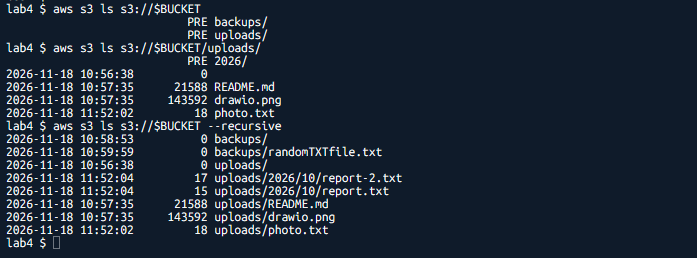
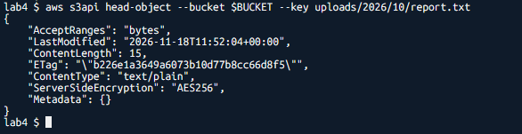

**Контрольные вопросы:**

- **Почему первая команда ls показывает PRE uploads/ и PRE backups/, а третья —
  полные ключи?** `aws s3 ls s3://$BUCKET` показывает только первый уровень
  вложенности: общие префиксы помечаются как `PRE` (prefix). Команда с
  `--recursive` обходит все уровни и печатает полные ключи объектов целиком.
- **Какой Content-Type получил report.txt, хотя я его не указывал?**
  `text/plain` — CLI автоматически определил тип содержимого по расширению
  файла `.txt`.

## Задание 3. Политика бакета: только HTTPS

Добавлена политика бакета, которая запрещает (Deny) любые действия, если
запрос пришёл не по HTTPS (условие `aws:SecureTransport: false`).

```json
{
  "Version": "2012-10-17",
  "Statement": [{
    "Sid": "DenyNonHttps",
    "Effect": "Deny",
    "Principal": "*",
    "Action": "s3:*",
    "Resource": [
      "arn:aws:s3:::timecapsule-dev-uploads-danielrusnak2025",
      "arn:aws:s3:::timecapsule-dev-uploads-danielrusnak2025/*"
    ],
    "Condition": {"Bool": {"aws:SecureTransport": "false"}}
  }]
}
```

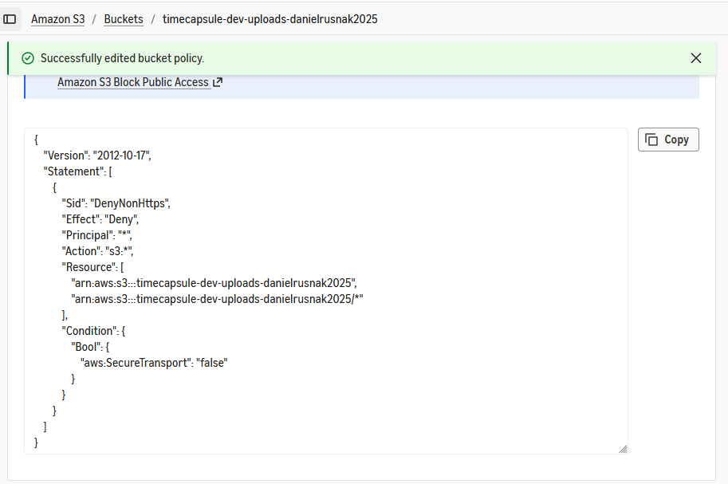
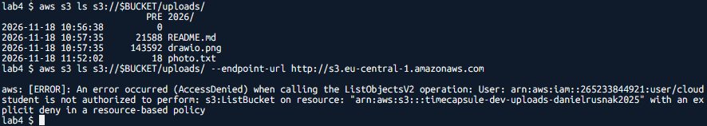

**Контрольные вопросы:**

- **Почему вторая команда получает AccessDenied, хотя у меня права
  администратора?** Явный Deny в IAM сильнее любого Allow. Запрос по HTTP
  попадает под условие `aws:SecureTransport: false`, срабатывает Deny, и даже
  права администратора его не отменяют (Explicit Deny > Allow).
- **Почему Block Public Access не помешал сохранить политику с
  "Principal": "*"?** BPA блокирует только политики, которые **разрешают
  (Allow)** публичный доступ. Наша политика ничего не открывает — она
  **запрещает (Deny)**, поэтому BPA её не трогает.

## Задание 4. Версионирование и защита от удаления

Включено версионирование. Создана история `notes.txt` (v1 → v2), затем
выполнены два разных удаления: delete marker и удаление конкретной версии.

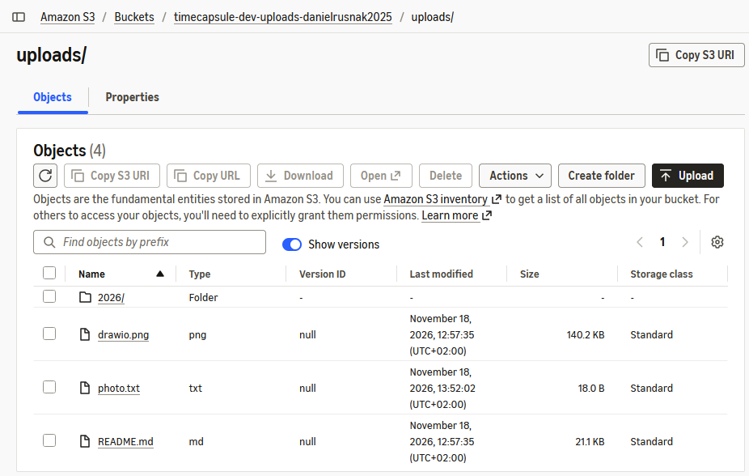
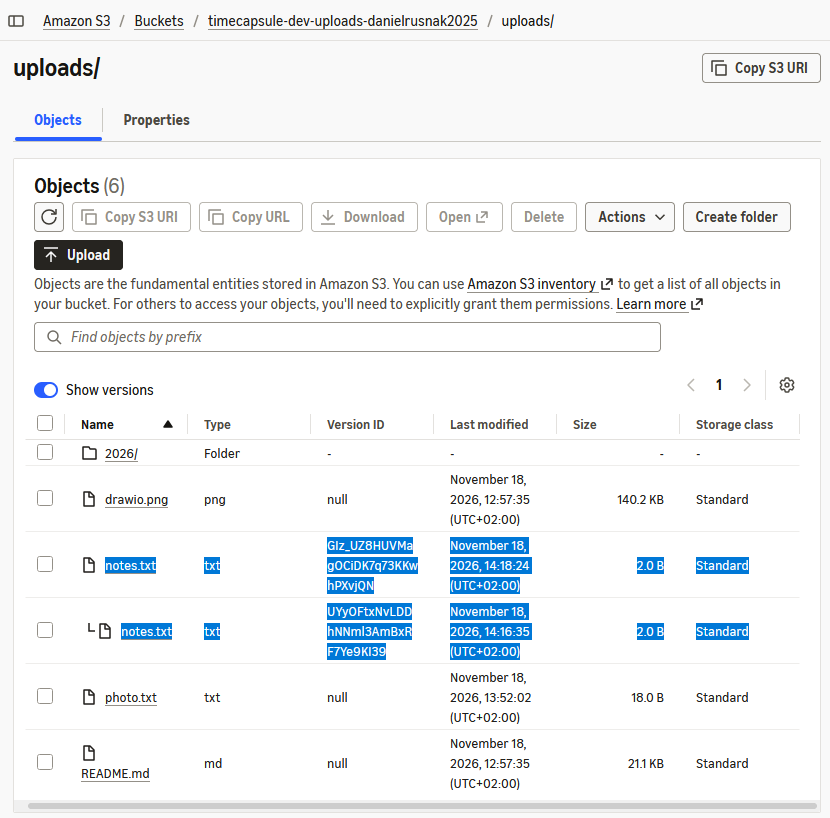
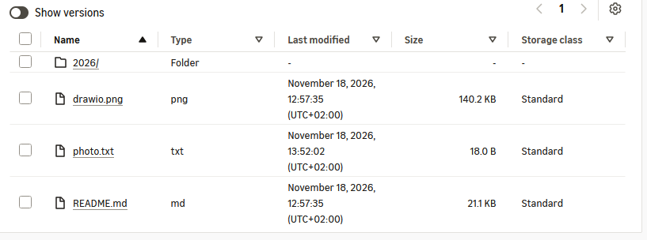
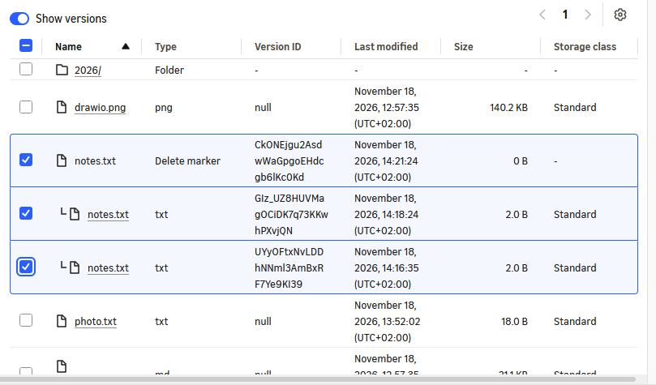
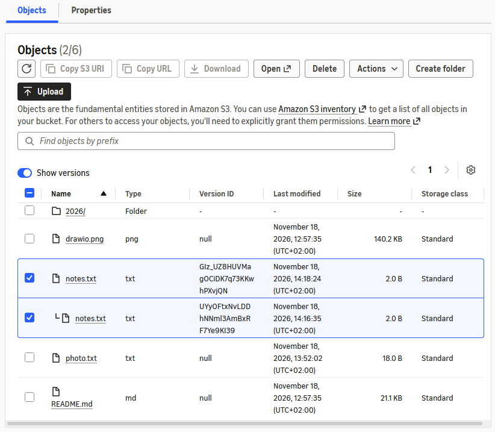
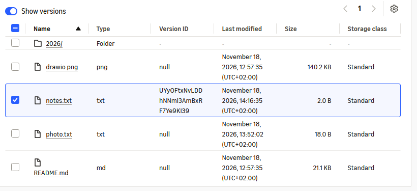

**Контрольные вопросы:**

- **Чем удаление в шаге 3 отличается от удаления в шаге 5?** В шаге 3 (Show
  versions выключен) удаляется **текущая версия объекта по ключу** — S3 кладёт
  сверху delete marker, а данные остаются целыми. В шаге 5 удаляется
  **конкретная версия по Version ID** — её байты стираются физически.
- **Какое из них можно отменить?** Только первое (delete marker): удалив сам
  маркер, возвращаем файл. Удаление версии по Version ID необратимо.
- **Какой способ защищает от случайного удаления, а какой нужно запрещать
  приложению?** Delete marker защищает (обратим), поэтому обычное удаление
  приложению давать можно. Удаление версии (`s3:DeleteObjectVersion`)
  необратимо — его приложению запрещают, чтобы нельзя было уничтожить историю.

## Задание 5. Правило жизненного цикла

Настроено правило управления старыми версиями: неактуальные версии переходят в
Standard-IA через 30 дней и удаляются через 90 дней.

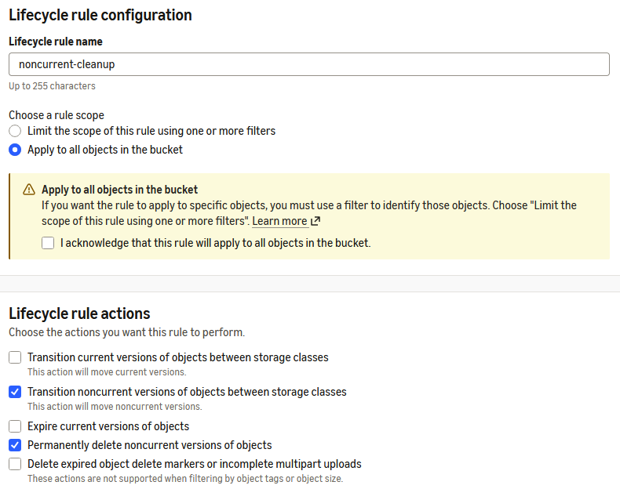
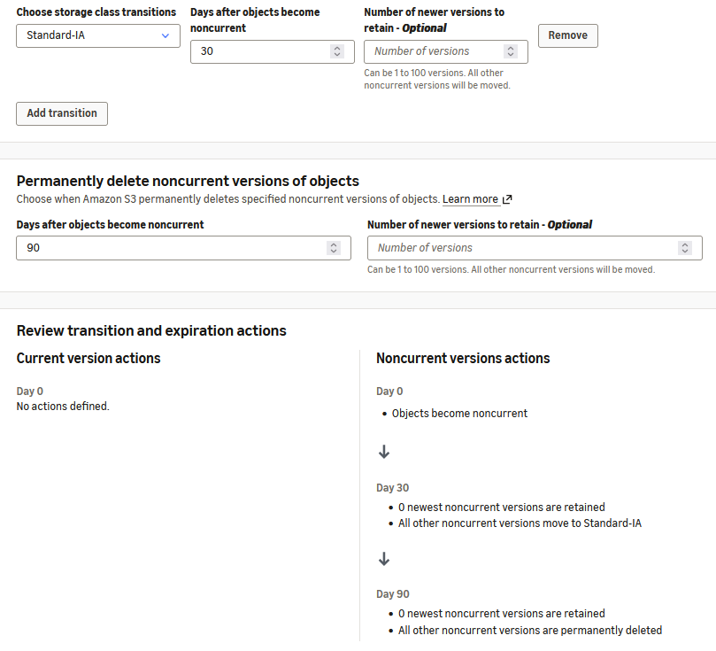

**Контрольные вопросы:**

- **Как поведёт себя правило для файла, который перезаписывали 10 раз за
  неделю?** Каждая перезапись делает прежнюю текущую версию неактуальной
  (noncurrent). У каждой такой версии свой отсчёт: через 30 дней после того,
  как версия стала неактуальной, она переходит в Standard-IA, через 90 дней
  удаляется. То есть 9 старых версий последовательно уйдут в IA и затем будут
  удалены по мере старения.
- **Почему маленькие тестовые файлы в Standard-IA не попадут?** Они не доживут
  до 30 дней неактуальности в рамках лабораторной — переход происходит только
  по истечении срока.
- **Что такое незавершённая загрузка частями и почему за неё платят?**
  Multipart upload — загрузка большого объекта по частям. Если загрузка
  оборвалась, уже залитые части остаются в бакете, занимают место и
  тарифицируются, хотя целого объекта нет. Правило удаляет такие «обрывки».

## Задание 6. Подписанные URL

Создан presigned URL из CLI (`aws s3 presign`), файл открылся в браузере, хотя
бакет приватный.

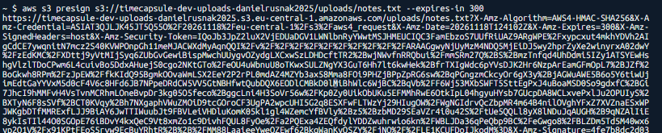
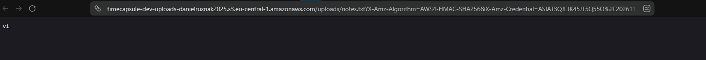

> Подпись `X-Amz-Signature` в ссылке обрезана перед публикацией.

**Контрольные вопросы:**

- **Какие ошибки вернул S3?** Просроченная ссылка → ошибка срока действия
  (Request has expired / AccessDenied).
- **Почему нельзя получить другой файл, просто поменяв ключ в ссылке?** Подпись
  рассчитывается для конкретного ключа, метода и срока. Меняя ключ, мы ломаем
  подпись → SignatureDoesNotMatch.
- **Обращалась ли команда presign к S3?** Нет. `aws s3 presign` формирует и
  подписывает URL локально, по сохранённым credentials, без запроса к S3.

---

# Часть 2. Продвинутый уровень

## Задание 7. Политика приложения

Описана IAM-политика приложения по принципу минимальных привилегий: ListBucket
только под префиксом `uploads/`, Get/Put/DeleteObject только на объекты
`uploads/*`. Нет `s3:*`, нет `Resource: "*"`, нет `DeleteObjectVersion`.

```json
{
  "Version": "2012-10-17",
  "Statement": [
    {
      "Sid": "ListOnlyUploadsPrefix",
      "Effect": "Allow",
      "Action": "s3:ListBucket",
      "Resource": "arn:aws:s3:::timecapsule-dev-uploads-danielrusnak2025",
      "Condition": { "StringLike": { "s3:prefix": ["uploads/*"] } }
    },
    {
      "Sid": "ReadWriteDeleteUploadsObjects",
      "Effect": "Allow",
      "Action": ["s3:GetObject", "s3:PutObject", "s3:DeleteObject"],
      "Resource": "arn:aws:s3:::timecapsule-dev-uploads-danielrusnak2025/uploads/*"
    }
  ]
}
```

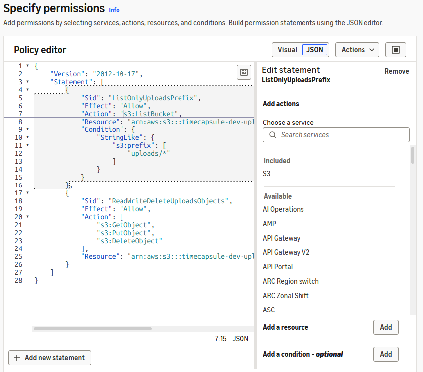

**Контрольные вопросы:**

- **Почему s3:ListBucket относится к ресурсу «бакет», а s3:GetObject — к
  ресурсу «объект»?** Это действия разного уровня: ListBucket — операция над
  бакетом (ARN без `/*`), Get/Put/Delete — операции над объектами (ARN с
  `/uploads/*`).
- **Что произойдёт, если перепутать ARN?** Разрешение не совпадёт с уровнем
  действия и не применится — запрос получит AccessDenied, хотя политика
  синтаксически верна.

## Задание 8. Проверка прав через тестовую роль

Создана тестовая роль `timecapsule-dev-s3-tester` (Trusted entity: AWS account
→ This account) с политикой `timecapsule-dev-app-s3`. Роль взята на себя через
`aws sts assume-role`, под её правами прогнаны 10 команд.

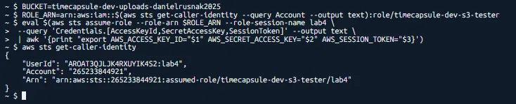
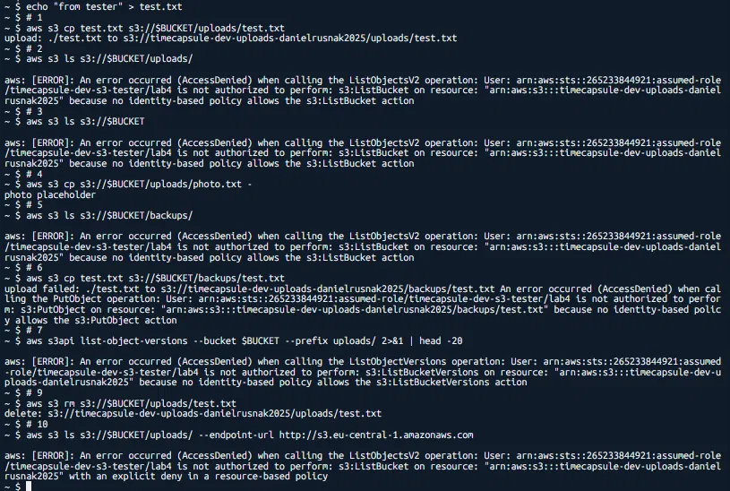
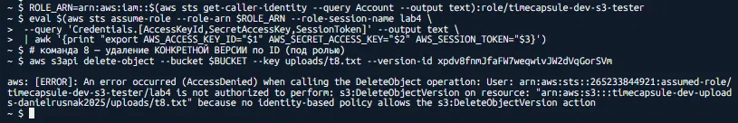

> Примечание: на момент проверки политика приложения уже урезана (задание 13 —
> убран `s3:ListBucket`), поэтому команды со списком объектов дают AccessDenied
> по неявному запрету. Это наглядно показывает принцип минимальных привилегий.

| № | Команда | Ожидал | Получил | Какое правило сработало |
|---|---------|--------|---------|------------------------|
| 1 | `cp test.txt → uploads/` | разрешено | ✅ upload | Allow (PutObject на uploads/*) |
| 2 | `ls uploads/` | AccessDenied | ❌ denied | Неявный запрет (нет ListBucket) |
| 3 | `ls` (весь бакет) | AccessDenied | ❌ denied | Неявный запрет (нет ListBucket) |
| 4 | `cp uploads/photo.txt -` | разрешено | ✅ `photo placeholder` | Allow (GetObject на uploads/*) |
| 5 | `ls backups/` | AccessDenied | ❌ denied | Неявный запрет (нет ListBucket) |
| 6 | `cp test.txt → backups/` | AccessDenied | ❌ denied | Неявный запрет (PutObject только на uploads/*) |
| 7 | `list-object-versions` | AccessDenied | ❌ denied | Неявный запрет (нет ListBucketVersions) |
| 8 | `delete-object --version-id` | AccessDenied | ❌ denied | Неявный запрет (нет DeleteObjectVersion) |
| 9 | `rm uploads/test.txt` | разрешено | ✅ delete (marker) | Allow (DeleteObject на uploads/*) |
| 10 | `ls uploads/` по HTTP | AccessDenied | ❌ denied | **Явный Deny** в политике бакета (HTTPS-only) |

**Контрольные вопросы:**

- **Чем политика доверия роли отличается от политики прав?** Trust-policy
  определяет, *кто* может принять роль (здесь — мой аккаунт через
  `sts:AssumeRole`). Permissions-policy определяет, *что* роль умеет (Get / Put /
  Delete на `uploads/*`).
- **Что произошло с test.txt после команды 9, можно ли восстановить?**
  DeleteObject при включённом версионировании поставил delete marker — объект
  «скрылся», но прежняя версия цела, поэтому его можно восстановить, удалив
  delete marker.
- **Сможет ли злоумышленник с credentials приложения уничтожить файлы
  безвозвратно?** Нет: у роли нет `s3:DeleteObjectVersion` (команда 8 →
  AccessDenied), поэтому стереть версию навсегда нельзя — только поставить
  обратимый delete marker.
- **А если бы в политике было s3:\*?** Тогда роль получила бы все действия,
  включая `DeleteObjectVersion`, `PutBucketPolicy`, `DeleteBucket` —
  злоумышленник смог бы безвозвратно уничтожить данные, открыть бакет публично
  или удалить его. Поэтому `s3:*` недопустим.

Важный вывод: команды 2 и 10 обе вернули AccessDenied, но по разным причинам.
№2 — **неявный запрет** (нет Allow на ListBucket). №10 — **явный Deny** в
политике бакета (запрос по HTTP под условием `aws:SecureTransport: false`).
Это демонстрирует порядок вычисления прав в IAM: **Explicit Deny > Allow >
Implicit Deny**.

## Задание 9. Роль сервера

Создана роль `timecapsule-dev-app-role` (Trusted entity: AWS service → EC2) с
политикой `timecapsule-dev-app-s3` и привязана к app-server. Проверено: сервер
работает с S3 без ключей, через роль.

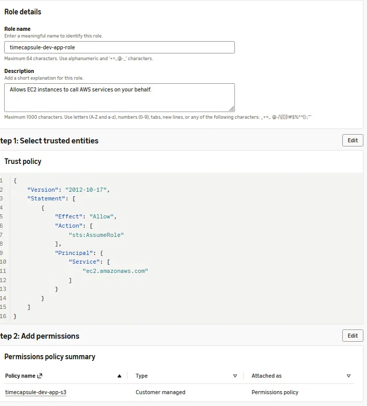
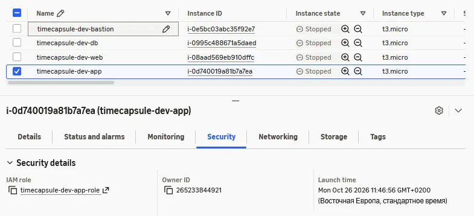
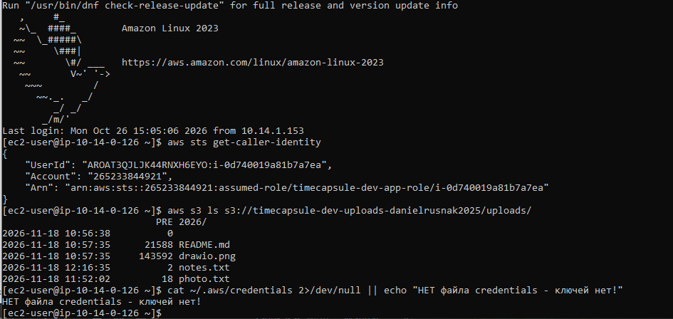

Вывод на сервере: `aws sts get-caller-identity` показал
`assumed-role/timecapsule-dev-app-role/...`, `aws s3 ls` увидел содержимое
`uploads/`, файла `~/.aws/credentials` на сервере нет.

**Контрольные вопросы:**

- **Где CLI на сервере взял credentials?** Из Instance Metadata Service
  (`169.254.169.254`): прикреплённая роль выдаёт туда временные учётные данные,
  которые CLI забирает и обновляет автоматически.
- **Чем политика доверия (trust) отличается от политики прав?** Trust-policy
  определяет, **кто** может принять роль (`sts:AssumeRole`, principal —
  `ec2.amazonaws.com`). Permissions-policy определяет, **что** роль умеет
  (работа с S3).
- **Почему такие credentials безопаснее ключа в .env?** Они временные и
  ротируются сами, на диске их нет — нечего украсть; роль легко отозвать без
  перевыпуска ключей.

## Задание 10. Перенос существующих файлов

Файлы перенесены командой `aws s3 sync` (сначала `--dryrun`, затем по-настоящему).
Повторный `--dryrun` пуст — всё в бакете. Content-Type перенесённого PNG =
`image/png`.

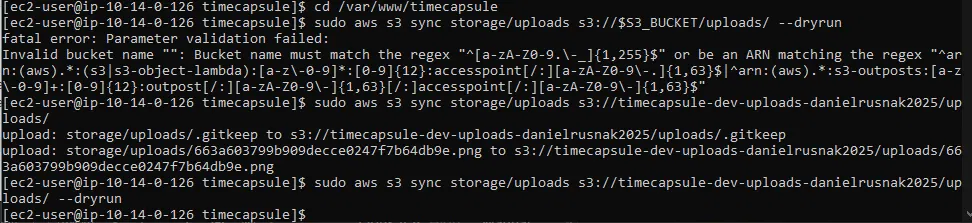
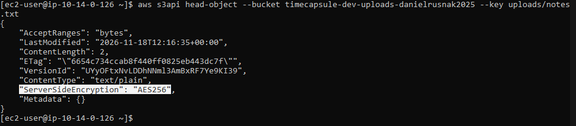
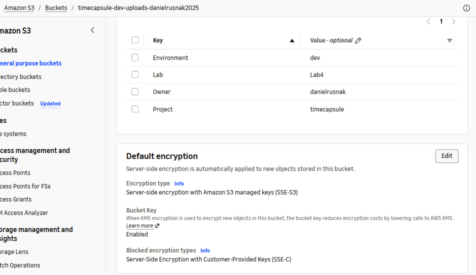

**Контрольные вопросы:**

- **Хватило ли прав политики приложения?** Да. `sync` использовал ListBucket
  (сравнить, что уже есть) и PutObject (загрузить новое) — оба под `uploads/`.
- **Что означает SSE-S3?** Server-Side Encryption с ключами, которыми управляет
  сам S3 (AES-256). Шифрование **на покое** (at rest) — на дисках S3; защита
  **в пути** обеспечивается отдельно, через HTTPS (задание 3). SSE-KMS отличается
  тем, что ключами управляешь ты через AWS KMS, с аудитом и контролем доступа.

## Задание 11. Модуль хранения на S3

Переписан модуль `src/storage.php` (вариант `open_capsules_php_functional`) на
AWS SDK: `storage_save()` → `putObject`, `storage_delete()` → `deleteObject`,
`storage_stream()` → 302-редирект на presigned URL (5 минут). Подключён
`aws/aws-sdk-php`, добавлены `S3_BUCKET`/`AWS_REGION` в `.env.example`, подвал
страницы показывает имя бакета вместо локального диска. Ключей AWS в `.env` нет.

**Изменения в репозитории:**
https://github.com/DanielRusnak2025-cloud/timecapsule/commits/main
(коммит «Lab4: move attachment storage to Amazon S3»)

## Задание 12. Деплой и проверка

Выполнен `composer install`, перезапущены php-fpm и nginx. Созданы новые
капсулы: файл загрузился в S3 под `uploads/`, при открытии вложения в адресной
строке — адрес `...s3.eu-central-1.amazonaws.com/uploads/...` с параметрами
`X-Amz-*`. Старые капсулы тоже отдают вложения из S3.

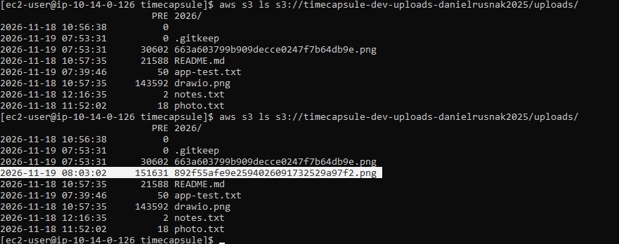
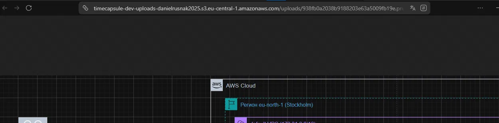

> Подпись `X-Amz-Signature` в адресе обрезана перед публикацией.

**Контрольные вопросы:**

- **Почему ссылку, пересланную другу, не нужно отзывать?** Presigned URL живёт
  5 минут и сам становится недействительным — отзывать нечего.
- **Что осталось в бакете после удаления капсулы и когда исчезнет
  окончательно?** Остаётся delete marker поверх версий объекта; прежние версии
  живут, пока их не уберёт правило жизненного цикла (noncurrent → Standard-IA
  через 30 дней, удаление через 90).

## Задание 13. Сервер без состояния

Локальная папка `storage/uploads` перемещена/удалена — приложение продолжает
отдавать вложения из S3 (stateless). Политика урезана: убран `s3:ListBucket`
(его использовал только `sync`). Приложение работает, а `aws s3 ls` на сервере
теперь даёт AccessDenied.

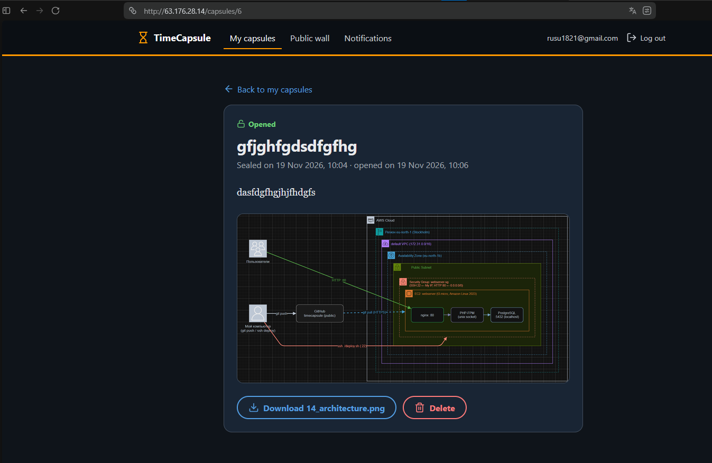
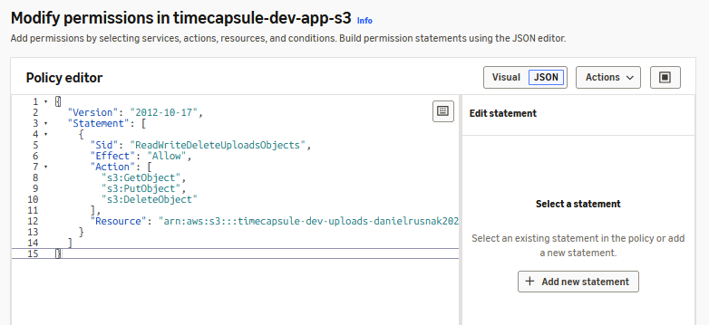
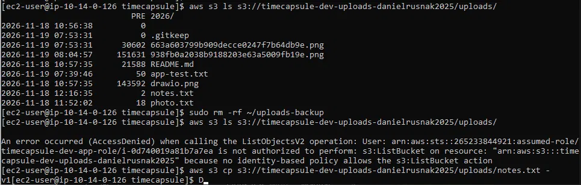

**Контрольные вопросы:**

- **Почему S3 ответил серверу и мне по-разному на несуществующий объект?** У
  роли приложения нет `ListBucket`, поэтому на отсутствующий объект S3 отвечает
  **AccessDenied** (не раскрывает, существует ли он) — у моего пользователя
  есть ListBucket, и он получает **NoSuchKey (404)**.
- **Зачем так?** Чтобы без права на список нельзя было перебором выяснять, какие
  ключи существуют: отсутствие и запрет выглядят одинаково.
- **Что нужно, чтобы заменить app-server новым без потери данных?** Ничего, что
  касалось бы файлов: вложения в S3, сервер stateless. Достаточно поднять новый
  инстанс с той же ролью и кодом.

## Задание 14. Архитектура и решение

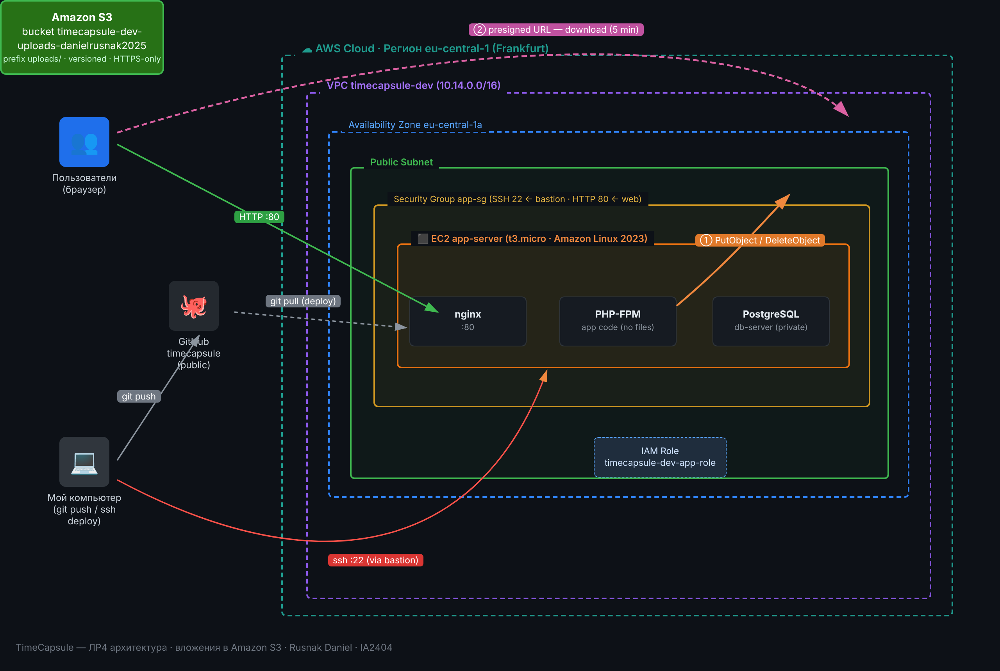

Решение о хранилище вложений записано в
[docs/adr/0003-attachment-storage.md](../adr/0003-attachment-storage.md):
сравнение EBS / EFS / S3, выбор S3, последствия (presigned URL и срок ссылки;
версионирование и lifecycle; масштабирование за балансировщиком).

---

## Устные вопросы (продвинутый уровень)

1. **Как проходит запрос на скачивание вложения?** Пользователь нажимает
   ссылку → приложение **проверяет права пользователя на капсулу** → вызывает
   `storage_stream()`, который создаёт presigned URL (5 мин) и отдаёт браузеру
   302-редирект → браузер скачивает файл **напрямую из S3**. Права пользователя
   приложения проверяются в коде **до** генерации ссылки; права роли — на
   стороне S3 при подписи/отдаче объекта.

2. **Что не даёт постороннему открыть вложение по прямому адресу?** Block Public
   Access и отсутствие публичной политики (прямой анонимный URL → AccessDenied);
   доступ возможен только по presigned URL, а он ограничен подписью, конкретным
   ключом и сроком 5 минут.

3. **Почему через presigned URL, а не открытый на чтение бакет?** Открытый
   бакет дал бы доступ всем ко всем файлам без контроля. Presigned URL выдаёт
   доступ точечно (один объект, один метод, короткий срок) и только после
   проверки прав в приложении.

4. **Как изменится схема при отказоустойчивости на уровне региона?** Нужно
   реплицировать бакет в другой регион (Cross-Region Replication) и разместить
   резервную инфраструктуру там; S3 по умолчанию переживает отказ зоны внутри
   региона, но не всего региона.
